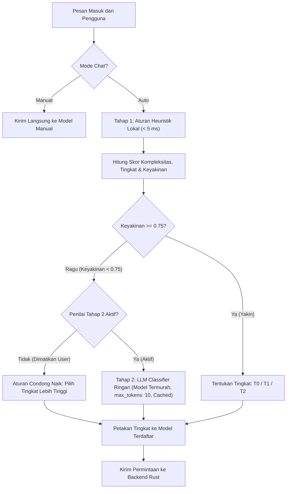
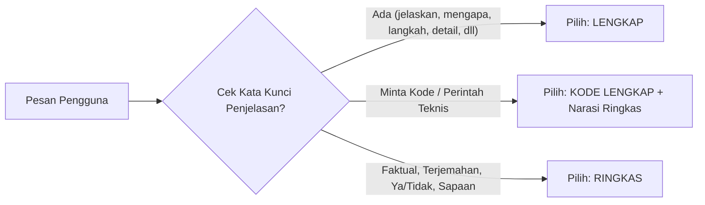

# DOKUMEN RANCANGAN A1: ARSITEKTUR ROUTER MODEL OTOMATIS, KONTROL PANJANG JAWABAN, DAN PEMILIH MODEL (BYOK)

> Berkas Hasil Langkah A1 (Protokol `router-token.md`)  
> Tanggal Rancangan: 11 November 2026  
> Sifat: Dokumen perancangan teknis (tanpa penulisan kode aplikasi sampai disetujui).

---

## 1. Pemilih Model dan Kendali Pengguna

### 1.1 Entri "Auto" di Dropdown Model
* **Letak & Hirarki**: Entri `"Auto"` diletakkan di urutan paling atas di dalam daftar dropdown model yang sama (`AiChatModelDropdown.tsx`), bukan sakelar tersembunyi di tab pengaturan terpisah.
* **Teks & Petunjuk**:
  * Judul: **Auto (Hemat & Cerdas)**
  * Subjudul/Petunjuk ringkas: *"Memilih model sesuai kesulitan pesan untuk menghemat kuota"*
  * Icon: Badge kilat adaptif / Sparkles biru berputar halus.
* **Ketersediaan**:
  * Hanya model dari penyedia yang API key-nya terpasang dan valid yang masuk ke daftar dan dapat dipilih oleh router Auto.
  * **Kasus Khusus 1 Model Valid**: Jika pengguna hanya memasukkan satu API key dengan satu model (misal hanya DeepSeek V3), Auto tetap bisa dipilih namun antarmuka secara transparan menampilkan catatan:
    > *"Hanya satu model terpasang, pemilihan otomatis tidak menghemat biaya rute. Penghematan tetap datang dari jawaban ringkas."*
  * **Kasus Khusus 0 Model Valid**: Menampilkan keadaan kosong (*empty state*) ramah yang mengarahkan tombol langsung ke modal pengaturan API key.

### 1.2 Matriks Perilaku: Auto vs Manual

| Fitur / Skenario | Mode Auto Terpilih | Model Tertentu Terpilih (Manual) |
|---|---|---|
| **Penentuan Model** | Dinamis per pesan berdasarkan klasifikasi T0 (Ringan), T1 (Standar), atau T2 (Kuat). | Statis 100% menggunakan model yang dipilih pengguna. Router **dilarang keras** mengganti model secara diam-diam. |
| **Model Gagal / Batas Laju (Rate Limit)** | Otomatis fallback ke model setingkat lain atau model tingkat di atasnya, dengan label pemberitahuan transparan. | Tampilkan pesan error resmi dari penyedia, sertakan tombol *"Tawarkan beralih ke [Nama Model Lain]"* tanpa beralih diam-diam. |
| **Pintasan `/kuat` dan `/ringan`** | Diproses: `/kuat` memaksa eskalasi ke T2, `/ringan` memaksa ke T0 untuk pesan tersebut. | Diabaikan dengan pesan kecil: *"Pintasan /kuat hanya berlaku di mode Auto. Pesan ini tetap dikirim ke [Nama Model]."* |
| **Pintasan `/ringkas` dan `/lengkap`** | Berlaku penuh pada pesan tersebut. | Berlaku penuh pada pesan tersebut. |
| **Pengaturan "Gaya Jawaban"** | Berlaku untuk semua pesan. | Berlaku untuk semua pesan. |
| **Tombol "Jawab Lebih Teliti"** | Naik 1 tingkat (T0 -> T1, atau T1 -> T2) dan jalankan ulang prompt. | Membuka popover penawaran: *"Pilih model yang lebih kuat untuk mengulang jawaban ini:"* berisi daftar model T2 yang terdaftar. |
| **Penyimpanan Status** | Pilihan diingat di penyimpanan lokal (`island_ai_selected_mode = "auto"`). | Pilihan diingat di penyimpanan lokal (`island_ai_selected_mode = modelId`). |

---

## 2. Arsitektur Router (Mode Auto)

### 2.1 Definisi Tiga Tingkat (Tiers)
Tingkat dirancang berbasis konfigurasi dinamis (bebas dari hardcode nama model di logic utama):

1. **T0: Ringan (Fast & Micro-cost)**
   * *Kriteria*: Pertanyaan faktual pendek, sapaan, definisi istilah, terjemahan 1 kalimat, konversi satuan, matematika dasar 1 langkah.
   * *Karakteristik*: Latensi sangat rendah (< 1 detik), biaya terendah (target masukan < \$0.50/1M, keluaran < \$1.50/1M).
   * *Kandidat bawaan*: Gemini 2.0 Flash, DeepSeek V3, GPT-4o Mini, Claude 3.5 Haiku.
2. **T1: Standar (Medium & General Driver)**
   * *Kriteria*: Pertanyaan umum, penulisan draf email, perangkuman artikel sedang, penjelasan konsep, penulisan fungsi/skrip kode sederhana, perbandingan dua hal.
   * *Karakteristik*: Keseimbangan optimal antara penalaran dan biaya.
   * *Kandidat bawaan*: DeepSeek V3, GPT-4o, Claude 3.5 Sonnet, Grok 2.
3. **T2: Kuat (Deep Reasoning & Complex Architecture)**
   * *Kriteria*: Debugging bug rumit (stack trace, multi-threading), perancangan arsitektur sistem, pembuktian matematika multi-tahap, analisis dokumen panjang, keputusan teknis/bisnis berisiko tinggi.
   * *Karakteristik*: Penalaran mendalam (*extended thinking*), tidak mengorbankan ketelitian demi biaya.
   * *Kandidat bawaan*: Claude 3.7 Sonnet, DeepSeek R1, OpenAI o3-mini, Gemini 1.5 Pro, Claude Opus 3.

---

### 2.2 Penilaian Dua Tahap (Two-Stage Evaluation)



#### Tahap 1: Aturan Heuristik Lokal Bebas Biaya (Target Latensi < 5 ms)
Dijalankan secara lokal di JavaScript/TypeScript sebelum jaringan disentuh.
* **Keluaran**:
  * `tier`: `"T0"` | `"T1"` | `"T2"`
  * `confidence`: Rentang `0.0` sampai `1.0`
  * `matchedSignals`: Daftar sinyal yang terpicu

#### Tabel Sinyal dan Bobot Heuristik (Tahap 1)

| Kategori Sinyal | Pola Deteksi / Kata Kunci | Bobot Skor | Efek Tingkat |
|---|---|---|---|
| **Sapaan & Basa-basi** | `^(halo|hai|pagi|siang|malam|hey|hi|hello|tes|test|ping)$` (case-insensitive) | -50 | Sangat condong ke **T0** |
| **Faktual / Definisi Singkat** | `^(apa itu|siapa|kapan|dimana|ibukota|singkatan dari|definisi) ` dengan panjang < 60 karakter | -30 | Condong ke **T0** |
| **Hitungan Sederhana** | Perhitungan aritmatika dasar regex `^\d+[\s\+\-\*\/\%]+\d+$` | -40 | Condong ke **T0** |
| **Terjemahan Pendek** | `^(terjemahkan|translate) ` dengan panjang < 100 karakter | -20 | Condong ke **T0** |
| **Pesan Lanjutan Pendek** | `"lanjutkan"`, `"next"`, `"teruskan"`, `"yang tadi"` | Warisi | Mewarisi tingkat dari pesan asisten sebelumnya |
| **Blok Kode / Error Stack Trace** | Mengandung ` ``` `, `Traceback (most recent call last)`, `NullPointerException`, `panic:`, `Error:`, `at Object.` | +60 | Langsung memicu **T2** |
| **Formula / Soal Matematika Lanjut** | Simbol kalkulus/matematika `\int`, `\sum`, `matrix`, `integral`, `turunan`, `limit x->`, `probabilitas` | +50 | Langsung memicu **T2** |
| **Kata Kunci Analisis Kompleks** | `analisis`, `rancang`, `arsitektur`, `optimasi`, `refactor`, `debug`, `race condition`, `deadlock`, `desain sistem`, `buktikan`, `audit keamanan`, `security vulnerability` | +40 | Condong kuat ke **T2** |
| **Multi-Step Instructions** | Pesan memiliki > 2 tanda tanya `?`, atau penomoran list `1. ... 2. ... 3. ...` | +35 | Condong ke **T2** / **T1** |
| **Lampiran / Gambar / OCR Besar** | Pesan membawa lampiran gambar atau teks OCR aktif > 600 karakter | +30 | Minimal **T1**, jika ada kode menjadi **T2** |
| **Panjang Prompt > 1000 karakter** | Teks pesan panjang tanpa kata kunci khusus | +20 | Minimal **T1** |

* **Aturan Penting: CONDONG NAIK (Bias Upward)**:
  Jika skor berada di area batas ambang (ambigu antara T0 dan T1, atau antara T1 dan T2), sistem **selalu memilih tingkat yang lebih tinggi**. Salah mengirim pesan sulit ke model murah berdampak fatal pada kepuasan pengguna, sedangkan sedikit biaya ekstra jauh lebih aman.

#### Tahap 2: Penilai Opsional (Hanya Saat Keyakinan Rendah)
* Hanya dipanggil jika `confidence < 0.75` pada Tahap 1.
* Menggunakan model termurah milik pengguna (misal Gemini 2.0 Flash atau DeepSeek V3) dengan parameter `max_tokens: 5`, suhu 0.0.
* Prompt klasifikasi super ringkas:
  `Tentukan tingkat kesulitan pesan berikut (T0=sepele, T1=umum, T2=rumit): "[PROMPT]". Balas hanya 2 karakter: T0, T1, atau T2.`
* Hasil klasifikasi di-cache (LRU 100 entri) berdasarkan hash prompt.
* **Opsi Pengguna**: Penilai ini dapat dimatikan di pengaturan AI. Jika dimatikan, semua kasus ambigu Tahap 1 otomatis dieksekusi dengan aturan Condong Naik.

---

### 2.3 Pemetaan Tingkat ke Model Pengguna (Dynamic Slot Mapping)
Model yang menempati slot T0, T1, dan T2 ditentukan dari inventaris model pengguna yang aktif:

```typescript
export interface RouterTierMapping {
  t0ModelId: string; // Model cepat & murah
  t1ModelId: string; // Model serbaguna
  t2ModelId: string; // Model penalaran kuat
  t0Provider: AiProviderId;
  t1Provider: AiProviderId;
  t2Provider: AiProviderId;
}
```

* **Penyiapan Awal Otomatis (Auto-Bootstrap)**:
  Saat pengguna selesai menghubungkan API key, sistem mengecek tier katalog (`Fast` -> T0, `Medium` -> T1, `Max` -> T2).
* **Fleksibilitas Pengguna**: Pengguna dapat mengubah alokasi slot T0/T1/T2 di modal pengaturan sesuai preferensi pribadi.

---

## 3. Kontrol Panjang Jawaban

### 3.1 Tingkat Kepanjangan
Tersedia tiga mode panjang respons:
1. **RINGKAS (Default)**:
   * Menghilangkan basa-basi pembuka (*"Tentu, saya bantu..."*), tidak mengulang pertanyaan pengguna, dan tanpa salam penutup (*"Ada yang bisa dibantu lagi?"*).
   * Langsung menjawab inti persoalan dalam 1 sampai 3 kalimat padat.
2. **NORMAL**:
   * Penjelasan terstruktur dengan konteks wajar (1 sampai 3 paragraf).
3. **LENGKAP**:
   * Pembahasan komprehensif, mencakup latar belakang, langkah demi langkah, alternatif solusi, dan pertimbangan mendalam.

### 3.2 Aturan Deteksi Kepanjangan Otomatis



* **Sinyal LENGKAP**: Terpicu jika ada frasa:
  `jelaskan`, `kenapa`, `mengapa`, `bagaimana cara`, `langkah demi langkah`, `detail`, `lengkap`, `uraikan`, `analisis`, `bandingkan`, `beri contoh`, `apa alasannya`, `explain`, `why`, `how to`, `step by step`.
* **Pengecualian Wajib untuk Kode & Perintah Teknis**:
  * Blok kode, skrip terminal, atau konfigurasi **TIDAK BOLEH DIPOTONG**.
  * Instruksi singkat hanya berlaku untuk teks pengantar dan teks penjelas di luar blok kode. Kode yang dihasilkan harus utuh dan bisa langsung disalin-tempel.
* **Peringatan Keselamatan & Risiko**:
  * Peringatan bahaya data terhapus (misal `rm -rf`, `DROP TABLE`) atau peringatan keamanan wajib disertakan secara utuh.

### 3.3 Penanganan `max_tokens` Adaptif dan Tombol "Lanjutkan"
* `max_tokens` difungsikan sebagai **batas pengaman biaya (safety ceiling)**, bukan pemotong kalimat:
  * Mode RINGKAS: `max_tokens: 350`
  * Mode NORMAL: `max_tokens: 1000`
  * Mode LENGKAP / Kode: `max_tokens: 2500` (atau batas model)
* **Penanda Pemotongan**:
  Jika respons terhenti karena `finish_reason == "length"` (atau token terputus di tengah kalimat):
  * Tampilkan badge halus di bawah gelembung chat: *"Jawaban mencapai batas panjang aman"*
  * Sediakan tombol interaktif: `[▶ Lanjutkan Jawaban]` yang mengirim prompt internal `"Lanjutkan penjelasan tepat dari kata terakhir tanpa mengulang."`

---

## 4. Penghematan Tambahan

Berdasarkan temuan audit A0, tiga mekanisme penghematan tambahan diterapkan:

### 4.1 Jendela Riwayat Adaptif (Sliding Window)
* Tidak lagi mengirim seluruh riwayat tanpa batas.
* **Batas Jendela**: Kirim maksimal **8 pesan terakhir** (4 giliran tanya-jawab) ke payload API.
* **Pembersihan Lampiran Lawas**: Konteks gambar dan OCR teks pada giliran ke-3 ke atas otomatis dilepas dari payload API (hanya teks obrolan yang dipertahankan), menghemat ribuan token masukan tanpa merusak memori percakapan.

### 4.2 Caching Jawaban Lokal (Deterministic Cache)
* Pertanyaan faktual identik tanpa konteks personal (misal: *"ibu kota kanada"*, *"rumus luas lingkaran"*) di-cache secara lokal (TTL 7 hari). Jika terpicu, jawaban disajikan instan dengan 0 token pemakaian.

---

## 5. Arsitektur Kredensial dan Penyimpanan Key (BYOK)

### 5.1 Migrasi ke Windows Credential Manager
* **Komponen Backend**: Menggunakan Win32 Credential API (`Advapi32.dll` via fungsi safe wrapper di Rust `src-tauri/src/lib.rs`):
  * `CredWriteW` untuk menyimpan API key terenkripsi oleh DPAPI Windows pada target `GiliNotch/AiProvider/{providerId}`.
  * `CredReadW` untuk membaca key saat request HTTP akan dikirim.
  * `CredDeleteW` saat pengguna menghapus key.
* **Pembersihan Celah Keamanan (Zero Plaintext Policy)**:
  * Saat pertama kali dijalankan, fungsi `migrate_legacy_keys()` membaca key dari `localStorage` dan `settings.json`, menyimpannya ke Windows Credential Manager, lalu **menghapus secara permanen** salinan di `localStorage` dan `settings.json`.
  * Key tidak pernah dikirim ke webview atau dicatat di file log.

### 5.2 Validasi dan Penyamaran Key
* **Validasi Pemasukan**: Key diuji dengan panggilan 1-token (misal `/v1/models` atau prompt 1 kata). Key ditolak jika status 401/403.
* **Penyamaran UI**: Antarmuka hanya menampilkan 4 digit terakhir: `••••••••••••a1b2` dengan tombol "Ganti" dan "Hapus".

---

## 6. Anggaran, Estimasi Biaya, dan Privasi

### 6.1 Estimasi Biaya Transparan (Bukan Tagihan Resmi)
* Semua tampilan nominal biaya di antarmuka diberi label mutlak: **"Perkiraan Biaya (Taksiran)"**.
* Rumus: `((inputTokens / 1_000_000) * inputCost) + ((outputTokens / 1_000_000) * outputCost)`.
* Pengguna dapat mengubah tarif input dan output per model di konfigurasi.

### 6.2 Batas Anggaran Lokal & Peringatan 80%
* Pengguna dapat menetapkan batas bulanan (misal: Rp 50.000).
* Saat pemakaian mencapai 80%, muncul notifikasi banner kuning di chat.
* Saat pemakaian mencapai 100%, sistem menawarkan opsi: beralih otomatis ke slot T0 (terhemat) atau menghentikan chat sementara.

### 6.3 Privasi 100% On-Device
* Seluruh inferensi router, penilaian sinyal, dan penyimpanan kredensial berjalan murni di laptop pengguna.
* Data pesan hanya dikirim ke endpoint resmi penyedia yang dipilih pengguna. Tidak ada proxy server, analitik eksternal, atau telemetri Gili.

---

## 7. Sketsa Perubahan Antarmuka (UI Minimal)

### Sketsa 1: Dropdown Pemilih Model dengan Entri "Auto"
```
+-------------------------------------------------------+
|  MODEL TERSEDIA                                       |
|-------------------------------------------------------|
| [*] Auto (Hemat & Cerdas)                    [Bawaan] |
|     Memilih model sesuai kesulitan pesan              |
|-------------------------------------------------------|
| [ ] DeepSeek V3 (T0/T1)                       Fast    |
| [ ] Claude Sonnet 3.7 (T2)                    Max     |
| [ ] GPT-4o Mini (T0)                          Fast    |
|-------------------------------------------------------|
|  + Hubungkan / Kelola API Key                         |
+-------------------------------------------------------+
```

### Sketsa 2: Gelembung Balasan AI dengan Label Model & Tingkat
```
[Logo DeepSeek]  Canberra.
                 
                 [T0 · DeepSeek V3] [Ringkas] [18 token ~Rp 0.3] [Jawab Lebih Teliti]
```
*(Keterangan: Label kecil di bawah teks tidak mengganggu pembacaan, dan tooltip muncul saat kursor diarahkan).*

---

## 8. Skema Konfigurasi TypeScript

```typescript
export type RouterTier = "T0" | "T1" | "T2";
export type ResponseLengthMode = "auto" | "compact" | "normal" | "detailed";

export interface ModelPricingConfig {
  modelId: string;
  provider: AiProviderId;
  inputCostPer1M: number;
  outputCostPer1M: number;
  isCustomPrice?: boolean;
}

export interface RouterConfig {
  enabled: boolean; // default true untuk mode Auto
  defaultMode: "auto" | string; // "auto" atau modelId spesifik
  defaultLength: ResponseLengthMode;
  tierMapping: {
    T0: { provider: AiProviderId; modelId: string };
    T1: { provider: AiProviderId; modelId: string };
    T2: { provider: AiProviderId; modelId: string };
  };
  enableStage2Classifier: boolean; // default true
  confidenceThreshold: number; // default 0.75
  historyWindowSize: number; // default 8 pesan
  budget: {
    monthlyLimitIdr: number;
    warnAtPercent: number; // default 80
    actionOnLimit: "warn" | "downgrade_to_t0" | "block";
  };
}
```

---

## 9. Kesimpulan Kesiapan untuk Langkah A2

Dokumen rancangan A1 telah memetakan seluruh arsitektur router, kendali manual vs auto, penilaian heuristik berbobot, kontrol panjang jawaban, keamanan kredensial Windows, dan skema konfigurasi tanpa mengubah kode aplikasi. 

Sistem siap melanjutkan ke penyusunan set dataset uji di **Langkah A2** setelah persetujuan pemilik.

